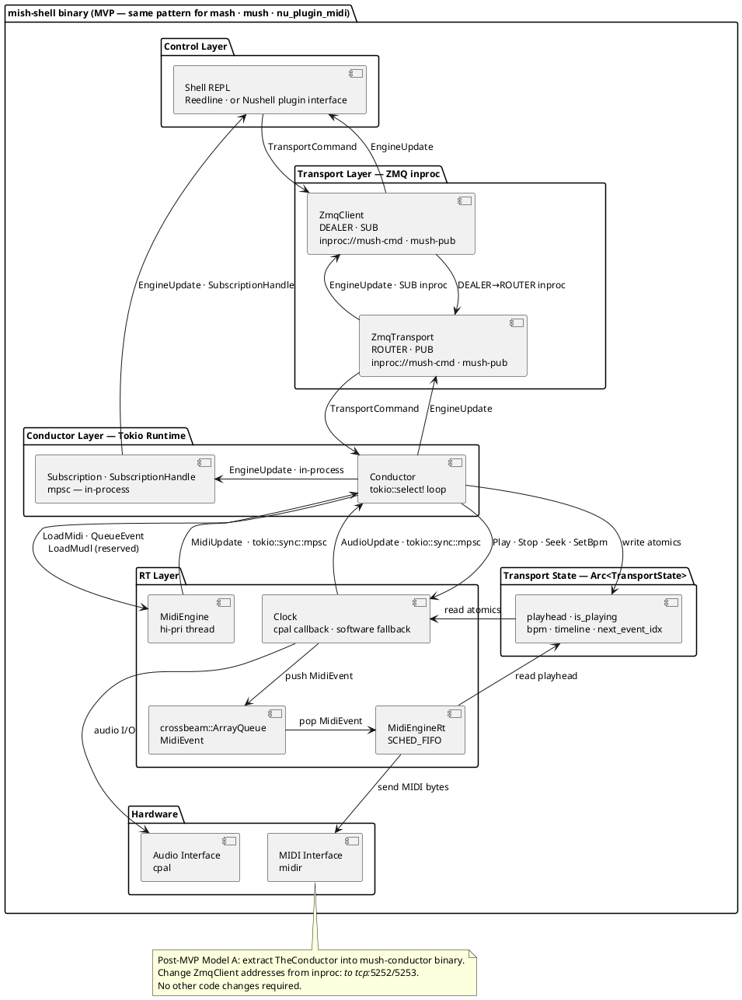

# Project Mid-Point Review

Here are the revised MVP requirements at mid-point project review. 

## Architecture

## Midi Commands

Available in mish, nu_midi_pligin, mush

ports - show available ports
port - no arg show active live port, with arg set active live port
send - midi event or segment to active live port
load - from file
    .mid 
    .mudl
play - play loaded file or recorded events
stop - stop playback or record - map tp space bar
monitor - stream received events to ui, buffer in memory for pre-roll record
record - buffer input events in memory, backup to temp file
save - to file 
    .mid
    .mudl

Post-MVP 

routes 
route 

## Audio Commands 

Available in mash, nu_plugin_live_audio, mush

hosts - show available hosts 
host - no arg show active/live host, with arg set active/live host
devices - show available devices
device - no args show active/live device, with arg set active/live device

Post MVP 

load - from file
play - play loaded file or recorded events
stop - stop playback or record - map tp space bar
monitor - stream received events to ui (meter, bar chart), buffer in memory for pre-roll record
record - buffer input audio in memory, backup to temp file
save - to file 
    .mid
    .mudl
routes
route 
    
## DAW Engines 

Host all shared functionality in mush-core.

MIDI specific functionality in mish-midi-core
Audio specific functionality in mash-audio-core

Shells and plugins are thin front-ends.

---

## Outcome 

#### 8.3.1 Audit `mish-midi-core` ✅ Complete

Findings:

**Production-ready — use as-is:**
- `enumerate.rs`        — `list_midi_ports()` via `midir`
- `timeline.rs`         — `load_midi()`, `load_midi_bytes()`, `TempoMap`
- `engine.rs`           — `DesktopMidiOutput`, `MidiEngineRt`
- `display.rs`          — `list_enumerated_devices()`
- `types.rs`            — `MidiPortInfo`, `MidiPortDirection`, `MidiError`

**Delete — superseded by Conductor + handle_command:**
- `engine.rs`           — `MidiEngine`, `MidiResponse`

**Missing — must be added:**
- `midir` input connection for `midi monitor`
- Port selection — `open_first_port()` hardcodes port 0
- `.mudl` writer
- `.mudl` parser
- Typed error for `load_midi_bytes` — currently `Box<dyn Error>`
- Replace all `eprintln!` in `clock.rs` with `tracing`

**Moves to `mush-core`:**
- `TimelineEvent
`    — made generic over payload type
                          `HasSamplePos` impl moves with it
- `EventPayload`        — renamed `MidiPayload`, stays in `mish-midi-core`
- `AudioPayload`        — stub in `mash-audio-core`, post-MVP
- `Clock`               — depends on `mush-core`; keeping it in
                          `mish-midi-core` creates a circular dependency
- `ClockArgs
`        — moves with `Clock`

**Stays in `mish-midi-core`:**
- `MidiPayload`         — renamed from `EventPayload`
- `load_midi()`         — returns `Vec<TimelineEvent<MidiPayload>>`
- `list_midi_ports()`
- `DesktopMidiOutput`
- `MidiEngineRt`
- `display.rs`
- `types.rs`

**Nothing moves to `mush-core` from `mish-midi-core` except:**
`TimelineEvent
`, `Clock`, `ClockArgs
`
`mush-core` already has everything else it needs.

**Circular dependency avoided by:**
`mush-core` owns `TimelineEvent
` and `Clock`.
`mish-midi-core` depends on `mush-core` — not the reverse.
`Conductor` in `mush-core` calls into `mish-midi-core` types
via trait objects or concrete types passed through `ClockArgs`.

